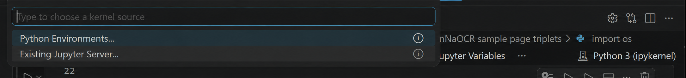

# Week 1 — Orientation: Lab Tutorial

[← Back to course README](../../README.md) · Next: [Week 2](../week-02-foundations/)

**Session:** no previous-week review (kickoff). Intro + journal club, then this lab.

## Week 1 checklist

- [ ] Form a team and confirm its assigned `projectgX` in the [registration sheet](https://docs.google.com/spreadsheets/d/1ney7yWJjEM0f7e5VavABcBsrqVyKQ9oC3Wt_NWoSojE/edit?usp=sharing).
- [ ] Verify membership in the `students` Unix group.
- [ ] Verify the team code/data workspaces are writable and shared course data is readable.
- [ ] Clone and install `/home/projectgX/project-ws2026`; read `AGENTS.md`.
- [ ] Create `/data/projectgX/lab-exercise` and set `LAB_WORKSPACE`.
- [ ] Submit the five-page sample preparation as a CPU-only `sbatch` job.
- [ ] Inspect the job's requested resources, state, and output log.
- [ ] Run the notebook inside a short CPU-only Slurm allocation and visualize line polygons and character-position boxes on all five pages.

**Deliverable:** a working lab environment, a successful Slurm job, and five persistent
sample page triplets whose line annotations and character-position boxes the team has
inspected and visualized.

## Provided lab materials

This lab repository provides the access instructions, shared Week 1 utilities, sample
batch job, and visualization notebook. It is not the team's project repository. Teams
may use the [optional project contract](../../docs/PROJECT-CONTRACT.md) when they decide
to create their own implementation repository.

## 1. Log in and identify your group

Log in with the server account supplied by the lecturer. Confirm the assigned group in
the [registration sheet](https://docs.google.com/spreadsheets/d/1ney7yWJjEM0f7e5VavABcBsrqVyKQ9oC3Wt_NWoSojE/edit?usp=sharing).
Replace `X` in every `projectgX` example below with that number. Never guess or use
another team's workspace.

## 2. Verify workspace and dataset access

| Purpose | Path | Access |
| --- | --- | --- |
| Git repositories, source, tests, and documentation | `/home/projectgX` | Team workspace |
| Lab datasets, models, predictions, logs, and generated outputs | `/data/projectgX/lab-exercise` | Team workspace |
| Shared course data | `/data/shared/project2026` | Read-only |

These checks answer four questions: are you in the course group, can you write code
and data in your team's own workspaces, and can you read the shared dataset? After
replacing `X`, run each command separately:

```bash
# Check that your account belongs to the course group.
groups | grep -qw students && echo "OK: course access"

# Check that you can create code files in your team's home workspace.
test -w /home/projectgX && echo "OK: code workspace"

# Check that you can save datasets and generated results.
test -w /data/projectgX && echo "OK: data workspace"

# Check that you can read the shared NomNaOCR dataset.
test -r /data/shared/project2026/nomnaocr && echo "OK: shared dataset"
```

Each command should print `OK`. If one prints nothing, stop and ask the lecturer or TA
to fix that access before continuing. These commands only check permissions; they do
not create or change any files. The batch job in Step 5 performs the detailed check of
the dataset's image and label files.

## 3. Clone and install the lab repository

```bash
# Move to your team's code workspace.
cd /home/projectgX

# Download the lab repository.
git clone https://github.com/ntcuong2103/project-ws2026.git

# Enter the downloaded repository.
cd project-ws2026

# Install the lab's Python environment and dependencies.
uv sync
```

Read [AGENTS.md](../../AGENTS.md) before using a coding agent in this repository.

## 4. Create the persistent lab workspace

Set the variable in every shell used to submit jobs or start Jupyter:

```bash
# Tell the lab tools where to store persistent outputs.
export LAB_WORKSPACE=/data/projectgX/lab-exercise

# Create folders for the outputs used throughout the course.
mkdir -p "$LAB_WORKSPACE"/{datasets,models,predictions,logs}
```

The complete layout and reuse rules are in the [lab data contract](../../docs/DATA-CONTRACT.md).

## 5. Prepare the sample with a CPU-only batch job

Submit the provided [`prepare_sample.sbatch`](prepare_sample.sbatch) from the repository
root. The job requests CPU and memory but deliberately has no `--gres` option, because
copying and validating five page triplets does not need a GPU. The partition is named
`gpu`, but a job receives a GPU only when it explicitly requests a GPU resource.

```bash
# Submit the sample-preparation job and capture Slurm's response.
submission=$(sbatch --parsable \
  --export=ALL,LAB_WORKSPACE="$LAB_WORKSPACE" \
  --output="$LAB_WORKSPACE/logs/%x-%j.out" \
  --error="$LAB_WORKSPACE/logs/%x-%j.err" \
  labs/week-01-orientation/prepare_sample.sbatch)

# Extract the numeric job ID from the response.
job_id=${submission%%;*}

# Print the job ID for use in the monitoring commands below.
echo "Submitted job $job_id"
```

The command means:

| Part | Purpose |
| --- | --- |
| `sbatch --parsable` | Submit a batch job and return only its job ID. |
| `--export=ALL,LAB_WORKSPACE=...` | Pass the current environment and canonical lab path into the job. |
| `--output` / `--error` | Keep Slurm logs under team-owned data storage. `%x` is the job name and `%j` the job ID. |
| `prepare_sample.sbatch` | Reproducible CPU resource request and command to run. |

Inspect the queued or running job and the resources Slurm assigned:

```bash
# Show the job's current queue state in a compact table.
squeue -j "$job_id" -o "%.10i %.12j %.2t %.10M %.4C %.10m %R"

# Show the job's complete Slurm configuration and allocation.
scontrol show job "$job_id"
```

In `scontrol` output, check `NumCPUs`, `MinMemoryNode`, `TimeLimit`, and `TRES`. There
should be no allocated `gres/gpu`. After the job finishes:

```bash
# Show the completed job's resource use and exit status.
sacct -j "$job_id" --format=JobID,State,Elapsed,AllocCPUS,ReqMem,MaxRSS,ExitCode

# Read the sample-preparation job's standard-output log.
cat "$LAB_WORKSPACE/logs/week01-prepare-$job_id.out"
```

The successful job creates or safely reuses five complete page triplets. A page is
eligible only when its image, line label, and detection label all exist at matching
relative paths:

```text
/data/projectgX/lab-exercise/datasets/nomnaocr-sample/images
/data/projectgX/lab-exercise/datasets/nomnaocr-sample/line_labels
/data/projectgX/lab-exercise/datasets/nomnaocr-sample/detection_labels
/data/projectgX/lab-exercise/datasets/nomnaocr-sample/manifest.json
```

The line labels provide quadrilateral regions and transcriptions. The detection labels
provide normalized character-position boxes, but they do not say which character is in
each box. The manifest records paths and checksums for every file in each triplet.

It only reads `/data/shared/project2026/nomnaocr`. If access fails, contact Dr. Cường
or TA Dương rather than changing permissions or writing into shared storage.

## 6. Open a short interactive allocation

Use a CPU-only interactive allocation for the exploratory notebook:

```bash
# Start a 30-minute interactive shell with CPU and memory resources.
srun --partition=gpu --account=lab --qos=normal \
  --nodes=1 --ntasks=1 --cpus-per-task=2 --mem=4G --time=00:30:00 \
  --pty bash
```

| Option | Purpose |
| --- | --- |
| `--partition=gpu --account=lab --qos=normal` | Select the course Slurm partition, account, and normal queue policy. |
| `--nodes=1 --ntasks=1` | Request one process on the single server node. |
| `--cpus-per-task=2 --mem=4G` | Reserve modest CPU and memory resources. |
| `--time=00:30:00` | Automatically release the allocation after 30 minutes. |
| `--pty bash` | Start an interactive shell inside the allocation. |

No GPU is requested. Inside the shell, confirm the allocation and inspect it:

```bash
# Print the current Slurm allocation's job ID.
echo "SLURM_JOB_ID=$SLURM_JOB_ID"

# Print the server running the interactive shell.
hostname

# Inspect the resources assigned to the interactive allocation.
scontrol show job "$SLURM_JOB_ID"
```

Run `exit` when finished so the resources are released immediately.

## 7. Inspect and visualize both annotation levels

Inside the interactive allocation, return to the lab repository, restore the workspace
variable if necessary, and start Jupyter:

```bash
# Return to the lab repository.
cd /home/projectgX/project-ws2026

# Restore the persistent lab-output location in this shell.
export LAB_WORKSPACE=/data/projectgX/lab-exercise

# Start the Jupyter server without trying to launch a browser on the compute node.
uv run jupyter lab --no-browser
```

Jupyter prints connection details similar to these when the server starts inside the
Slurm allocation:

```text
To access the server, open this file in a browser:
    file:///home/minhttn/.local/share/jupyter/runtime/jpserver-1556813-open.html
Or copy and paste one of these URLs:
    http://localhost:8888/lab?token=xxx
    http://127.0.0.1:8888/lab?token=xxx
```

The path and port may vary. By default, Jupyter also generates a new random token each
time a server process starts. Use the URL printed by your current Jupyter process; do
not reuse the example token above or a URL from an earlier server. In VS Code, open
the notebook, click the kernel name in the top-right corner, select **Existing Jupyter
Server...**, and paste the complete printed URL, including the `?token=...` query
parameter. Do not enter only `http://localhost:8888`: without the current token,
Jupyter cannot authenticate the connection and may respond with HTTP 403 Forbidden.
The full URL connects the notebook to the Jupyter server running inside the Slurm job
instead of starting a kernel outside the allocation. 



For each page, confirm that the red line polygons cover complete transcribed lines and
the cyan boxes localize individual characters. The cyan boxes are positions only; do
not interpret the class ID as a character identity. For additional commands, GPU
resource types, job states, cancellation, and efficiency checks, see the
[Slurm Quick Guide](../../SLURM-QUICK-GUIDE.md).

## Materials

- [`prepare_sample.sbatch`](prepare_sample.sbatch): CPU-only Slurm job.
- [`prepare_sample.py`](prepare_sample.py): thin command wrapper used by the job.
- [`visualize_sample_page.ipynb`](visualize_sample_page.ipynb): line-polygon and character-position-box visualization.
- [Lab data contract](../../docs/DATA-CONTRACT.md)
- [Optional team project contract](../../docs/PROJECT-CONTRACT.md)
