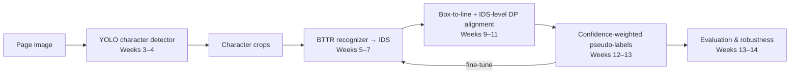

---
hide:
  - navigation
---

# Confidence-Weighted Nôm OCR

Teams of 3–4 build a full document-AI pipeline for historical Hán-Nôm pages: character
detection, radical-based (IDS) recognition, sequence alignment, and confidence-weighted
pseudo-labeling. The course follows a published research system, and every team runs the
complete pipeline on the NomNaOCR corpus (2,953 pages).

!!! warning "Course status · on break until December"
    Weeks 1–6 are done. Classes resume in **December with Week 7** (date to be announced), and
    the **Week 8 midterm is on Tuesday 15 December 2026**. Use the break to work through the
    Week 1–7 labs as practice, especially the new
    [Week 7 bidirectional decoder](weeks/week-07.md).

-   :material-rocket-launch-outline: **Getting started**

    ---

    Server account, team workspaces, cloning the lab repo, and your first Slurm job.

    [:octicons-arrow-right-24: Set up](getting-started.md)

-   :material-calendar-week: **This week: Week 7**

    ---

    Bidirectional greedy decoding, IDS→Unicode lookup, and the full detection + recognition
    demo.

    [:octicons-arrow-right-24: Open the lab](weeks/week-07.md)

-   :material-server-network: **Slurm quick guide**

    ---

    Batch jobs, interactive sessions, GPU and MIG types, and releasing resources.

    [:octicons-arrow-right-24: Read the guide](guides/slurm.md)

-   :material-database-outline: **Resources**

    ---

    Datasets on the server, the recognizer checkpoint, repositories, papers, and tools.

    [:octicons-arrow-right-24: Browse](resources.md)

-   :material-presentation: **Midterm**

    ---

    15-minute talk on detection and recognition, with a team-membership slide.

    [:octicons-arrow-right-24: Rules](guides/midterm.md)

-   :material-lifebuoy: **Help & FAQ**

    ---

    Common errors and their fixes, and who to ask.

    [:octicons-arrow-right-24: Get help](help.md)

## The pipeline

A character such as **安** is recognized as its Ideographic Description Sequence
**⿱宀女** (宀 on top of 女), so the recognizer can describe characters it has never seen
from parts it knows.

## Announcements

**16 Nov 2026** · Week 7 now teaches the **bidirectional** BTTR decoder, matching Dr. Cuong's
reference notebook. Week 6 has new setup steps for the recognizer
(`uv sync --group recognition`). See [Week 6](weeks/week-06.md) and [Week 7](weeks/week-07.md).

**16 Nov 2026** · This site launched. The lab repository remains the source of truth; every
week page is generated from it.
